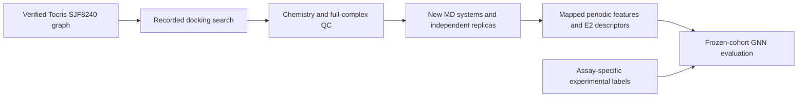

# Corrected SJF8240 workflow and retained historical results

Run from `prosettac_robust/workflow`. All output directories must be fresh.
The original projects are read-only references. Current release requirements are
in `../sjf8240_review/publication_readiness.json`; no production/training release
has been issued. The other compounds are deferred.



## Preserve and recompute

Keep historical runs, model files, predictions, source structures and all failure
records. The compiled historical SJF8240 systems have different connectivity;
do not edit old ITPs and resume old TPR/checkpoint files as corrected systems.
Revalidate any reused protein candidate geometry independently. Regenerate the
chemical pose, topology, production trajectory and chemistry-dependent features.
Use `../sjf8240_review/sjf8240_rerun_manifest.tsv` to trace the historical targets.

Freeze the experimental assay, compound identity, concentrations, time, controls,
endpoint and label evidence independently of model output. The historical
17-target cohort is a reference, not a newly certified label set. Do not treat
missing assay data, absent graphs or a failed finite search as a negative label.

## Docking and MD

Use the repaired controller's `--plan` and bounded `--run --pilot` modes with
explicit Python, seed and budgets. The `baseline_engine` directory retains the
working adapter sequence: randomized constrained global orientations, local
Rosetta docking, full two-head constrained linker construction and actual scoring.
It does not invoke the PatchDock executable. All rejection records are retained.

The initial linker feasibility search has explicit finite budgets. If its initial
bounded search fails, the existing policy may leave additional requested output
conformers unattempted; the per-pose ledger records attempted/unattempted searches.
The requested conformer cap does not certify exhaustive sampling or 100 failed
independent feasibility searches. Adequacy must be measured before campaign use.

For each QC-valid selected pose, `06_prepare_md.py` creates a fresh mapped system
from verified SJF8240 `neutral_reference` parameters. The corresponding
`07_run_md_stage.py` completes EM, NVT, restrained NPT, unrestrained NPT and then
production using immutable stage receipts. Check independent replicas and
convergence rather than assuming a fixed duration proves stability.

Production trajectory output is ordered SOLUTE-only. Create its bound topology:

```sh
python3 scripts/02_analysis/06_reduce_md_topology.py --help
```

Use `--work` for the newly completed system, `--stage prod`, the actual `--gmx`
executable and a fresh `--output` named `solute.tpr` inside that system. Preserve
its `.provenance.json`. Graph extraction requires both it and the completed
production receipt; equilibration or smoke receipts cannot become training data.

## New graph inputs

A screen directory contains `POI/pose_id/` systems. Each contains
`md_preparation.json`, `prod.receipt.json`, `prod.xtc`, `solute.tpr`, and
`solute.provenance.json`. Its `manifest.tsv` identifies `poi`, `pose_id`, `stage`;
only recorded completed production stages are eligible. Actual receipts and
compiled chemistry are checked even if a manifest claims completion.

`02_md_contact_graphs.py` requires explicit `--root`, fresh `--output` and
`--input-provenance`. The latter binds the manifest hash and verified molecular
identity and supplies `experimental_labels` (0/1 only if experimentally reviewed,
otherwise -1). It uses recorded atom groups, not residue-number guesses, and
measures periodic ligand-heavy/Cα contacts and observed joint contact frequency.
Unaligned residues and failed declared inputs are errors. Old implicit merge is
disabled. Graph arrays and per-pose input hashes are retained.

`03_static_contact_graph.py` requires a completed docking `--run`, target `--poi`,
explicit `--label` and fresh `--output`. It creates a nine-feature node graph,
three-feature contact edges and a hash-bound receipt. The real zero-pose path
creates a missing-graph receipt, not invented zero-valued molecular evidence.
`04_pack_static_graphs.py` packages an explicit list of verified `--graph` folders
into a new packet. Dimensional compatibility alone does not certify old weights.

## GNN evaluation

`01_sjf8240_e2_lopo.py` preserves the dual-encoder/E2 architecture and requires
explicit static/dynamic/scalar files, seed, fresh output and a reviewed release.
See `config/sjf8240_gnn_release.template.json`. The template is intentionally
unreleased and cannot start training. No historical graph/table is silently
upgraded. New scalar tables must declare `feature_schema` and `ligand_inchikey`,
contain explicit per-target provenance and recomputed E2 descriptors, and retain
missing observations as missing. Geometry descriptors remain heuristic features,
not demonstrated ubiquitination or calibrated degradation probabilities.

Training checks graph schema, finite tensor dimensions and indices, experimental
labels and protein identity groups. Unknown targets do not enter training;
aliases of the same protein cannot cross folds. Normalization is fitted on each
training fold. CPU execution uses fixed fold seeds and native PyTorch operators.
The runner checks source, release and input stability before writing predictions,
metrics and receipts. Missing dynamic/scalar observations are reported.

LOPO on a small development cohort remains exploratory. Report uncertainty,
selection/missingness, hyperparameter decisions and independent validation.
Do not tune labels or select a best seed after seeing performance.

## Verification already retained

`../validation_controls/regression/` contains both runtime regression logs.
The 200-conformer SJF8240 sampler comparison and native GNN forward/backward
control are recorded separately. Raw diagnostic runs are retained locally and
excluded from Git; compact receipts and exact source hashes are versioned.
Additional reference GSK215 controls are supplementary engine evidence, not
SJF8240 accuracy evidence. No original project files or global packages were
modified and no Ernie production campaign was submitted.
