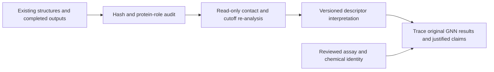

# Existing SJF8240: robust scripts and retained results

**2026-11-08 update:** completed the full 141-pose coherent E2 imaging sensitivity and retained stage/checkpoint audits. All 174 production checkpoints reach 20 ns. All 22,753 true-heavy bridging frames agree across three imaging conventions; 16 differences are nonbridging. One EM force-tolerance exception is disclosed. Analysis tests: 139 passed; docking: 135 passed / four PyG-only skips. See [COHERENT_E2_REANALYSIS.md](COHERENT_E2_REANALYSIS.md), [METHODS_DRAFT_RECONCILIATION.md](METHODS_DRAFT_RECONCILIATION.md), [RETAINED_GNN_MODEL_PROVENANCE.md](RETAINED_GNN_MODEL_PROVENANCE.md) and [PROTEIN_PANEL_19.md](PROTEIN_PANEL_19.md). Original results unchanged; unconditional biological/predictive sign-off remains withheld. Earlier dated counts below are historical checkpoints.


Run from `prosettac_robust/workflow`. All output directories must be fresh.
The original projects are read-only references. Current release requirements are
in `../sjf8240_review/publication_readiness.json`; no production/training release
has been issued. The other compounds are deferred. The current user scope is reuse of existing structures/results, not a new study campaign. Read `../USER_REQUIREMENTS.md` first. The old rerun manifest and corrected-chemistry campaign proposal are historical planning artifacts, not execution instructions.



## Active retained-structure analysis route

Read `../HISTORICAL_METHODS_AND_RATIONALE.md`. Reuse the original structures, trajectories and predictions. For a fresh core-layout retrospective contact output, run `scripts/02_analysis/09_reanalyze_existing_contacts.py --help`; this analysis entrypoint requires no replacement supplier parameters or fabricated new production receipt. Its qualified DDR2 control exactly reproduces the prior 201-row contact table. The two prediction-target directories do not contain the same legacy index/XVG layout, so do not guess their inputs.

Compiled settings for all 174 MD graph systems are in `../existing_result_audit/compiled_md_protocol_v1`. Actual cutoffs vary: 113 cases at 1.0 nm, 61 at 1.6 nm. Do not describe every old run using today's template. Those diagnostic MDP exports cannot be used to restart MD. Optional future controls below are not instructions to repeat the old experiment.

## Preserve and re-analyse existing results

Keep historical runs, model files, predictions, source structures and all failure
records. The compiled historical SJF8240 systems have different connectivity;
do not edit old ITPs and resume old TPR/checkpoint files as corrected systems.
The current task audits and re-analyses the actual retained systems. If a later study claims simulations of a different, verified chemical structure, its required new data must be decided separately; do not reinterpret an old TPR as a different molecule or automatically launch a replacement campaign.
Use `../sjf8240_review/sjf8240_rerun_manifest.tsv` only to trace the historical targets; it is not the current execution plan.

Freeze the experimental assay, compound identity, concentrations, time, controls,
endpoint and label evidence independently of model output. The historical
17-target cohort is a reference, not a newly certified label set. Do not treat
missing assay data, absent graphs or a failed finite search as a negative label.

## Retained E2 summaries after full-frame audit

Use `scripts/02_analysis/10_summarize_existing_e2.py --help` on a hash-bound frame packet and its pose audit receipt. Time bounds, duplicate policy and image policy are mandatory. The completed core audit/summaries are in `../existing_result_audit/e2_full_frames_v3` and `e2_explicit_window_all_core_v1`. Reuse those outputs instead of repeating the full sweep. Default scientific handling rejects an image flag; explicit audit-only output remains un-released. Do not pair arrays by truncating their lengths or call a virtual-point MIC calculation an approved physical correction. Read `../INTEGRATION_REVIEW_RESULTS.md` for completed checks and remaining biological limitations.

## Optional future docking/MD controls

For a separately chosen future control, the repaired controller has `--plan` and bounded `--run --pilot` modes with
explicit Python, seed and budgets. The `baseline_engine` directory retains the
working adapter sequence: randomized constrained global orientations, local
Rosetta docking, full two-head constrained linker construction and actual scoring.
It does not invoke the PatchDock executable. All rejection records are retained.

The initial linker feasibility search has explicit finite budgets. If its initial
bounded search fails, the existing policy may leave additional requested output
conformers unattempted; the per-pose ledger records attempted/unattempted searches.
The requested conformer cap does not certify exhaustive sampling or 100 failed
independent feasibility searches. Adequacy must be measured before campaign use.

For future explicitly chosen poses, `06_prepare_md.py` can create a fresh mapped system
from verified SJF8240 `neutral_reference` parameters. The corresponding
`07_run_md_stage.py` completes EM, NVT, restrained NPT, NPT with ligand restraints released, and then
production using immutable stage receipts. Check independent replicas and
convergence rather than assuming a fixed duration proves stability.

Production trajectory output is ordered SOLUTE-only. Create its bound topology:

```sh
python3 scripts/02_analysis/06_reduce_md_topology.py --help
```

Use `--work` for the newly completed system, `--stage prod`, the actual `--gmx`
executable and a fresh `--output` named `solute.tpr` inside that system. Preserve
its `.provenance.json`. Graph extraction requires both it and the completed
production receipt; equilibration or smoke receipts cannot become training data.

## New graph inputs

A screen directory contains `POI/pose_id/` systems. Each contains
`md_preparation.json`, `prod.receipt.json`, `prod.xtc`, `solute.tpr`, and
`solute.provenance.json`. Its `manifest.tsv` identifies `poi`, `pose_id`, `stage`;
only recorded completed production stages are eligible. Actual receipts and
compiled chemistry are checked even if a manifest claims completion.

`02_md_contact_graphs.py` requires explicit `--root`, fresh `--output` and
`--input-provenance`. The latter binds the manifest hash and verified molecular
identity and supplies `experimental_labels` (0/1 only if experimentally reviewed,
otherwise -1). It uses recorded atom groups, not residue-number guesses, and
measures periodic ligand-heavy/Cα contacts and observed joint contact frequency.
Unaligned residues and failed declared inputs are errors. Old implicit merge is
disabled. Graph arrays and per-pose input hashes are retained.

`03_static_contact_graph.py` requires a completed docking `--run`, target `--poi`,
explicit `--label` and fresh `--output`. It creates a nine-feature node graph,
three-feature contact edges and a hash-bound receipt. The real zero-pose path
creates a missing-graph receipt, not invented zero-valued molecular evidence.
`04_pack_static_graphs.py` packages an explicit list of verified `--graph` folders
into a new packet. Dimensional compatibility alone does not certify old weights.

## GNN evaluation

`01_sjf8240_e2_lopo.py` preserves the dual-encoder/E2 architecture and requires
explicit static/dynamic/scalar files, seed, fresh output and a reviewed release.
See `config/sjf8240_gnn_release.template.json`. The template is intentionally
unreleased and cannot start training. No historical graph/table is silently
upgraded. New scalar tables must declare `feature_schema` and `ligand_inchikey`,
contain explicit per-target provenance and recomputed E2 descriptors, and retain
missing observations as missing. Geometry descriptors remain heuristic features,
not demonstrated ubiquitination or calibrated degradation probabilities.

Training checks graph schema, finite tensor dimensions and indices, experimental
labels and protein identity groups. Unknown targets do not enter training;
aliases of the same protein cannot cross folds. Normalization is fitted on each
training fold. CPU execution uses fixed fold seeds and native PyTorch operators.
The runner checks source, release and input stability before writing predictions,
metrics and receipts. Missing dynamic/scalar observations are reported.

LOPO on a small development cohort remains exploratory. Report uncertainty,
selection/missingness, hyperparameter decisions and independent validation.
Do not tune labels or select a best seed after seeing performance.

## Verification already retained

`../validation_controls/regression/` contains both runtime regression logs.
The 200-conformer SJF8240 sampler comparison and native GNN forward/backward
control are recorded separately. Raw diagnostic runs are retained locally and
excluded from Git; compact receipts and exact source hashes are versioned.
Additional reference GSK215 controls are supplementary engine evidence, not
SJF8240 accuracy evidence. No original project files or global packages were
modified and no Ernie production campaign was submitted.


### Preserved local docking runtime (2026-11-06)

The licensed local overlay now resides privately at `prosettac_robust/.runtime/python310-packages`, hash-verified during guarded installation. Launch local docking Python with:

```sh
python3 /home/ayushregmibagale/10PROTAC-MD/prosettac_robust/workflow/scripts/00_runtime/docking_python.py YOUR_SCRIPT.py YOUR_ARGUMENTS
```

This prepends the preserved overlay and inherits it in child processes. The base `/home/ayushregmibagale/miniconda3/envs/deepternary/bin/python` and its fallback packages remain external dependencies; this is not a self-contained portable environment. Bare base Python uses an older RDKit and must not be substituted. Verified overlay versions: Python 3.10.22, RDKit 2025.09.5 with `SetCoordMap`, NumPy 2.2.6, OpenMM 8.4; PyRosetta imports from the preserved private path. Do not upload licensed binaries/database to GitHub or assume this local layout exists on Ernie.


### Future GNN checkpoints

The isolated runner writes a training intent before any future approved evaluation and one tensor-only checkpoint per held-out fold. Checkpoints retain weights, architecture, training-only scalar reference rows and the held-out normalized vector/score; `weights_only=True` restoration can replay inference without retraining. Prediction scores retain full precision. A completion receipt, not an intent/partial checkpoint, marks success. Existing historical predictions remain unchanged. Corrected role/periodic/joint features must be versioned and reviewed separately before any new evaluation; no SJF8240 training was started for these software checks.
